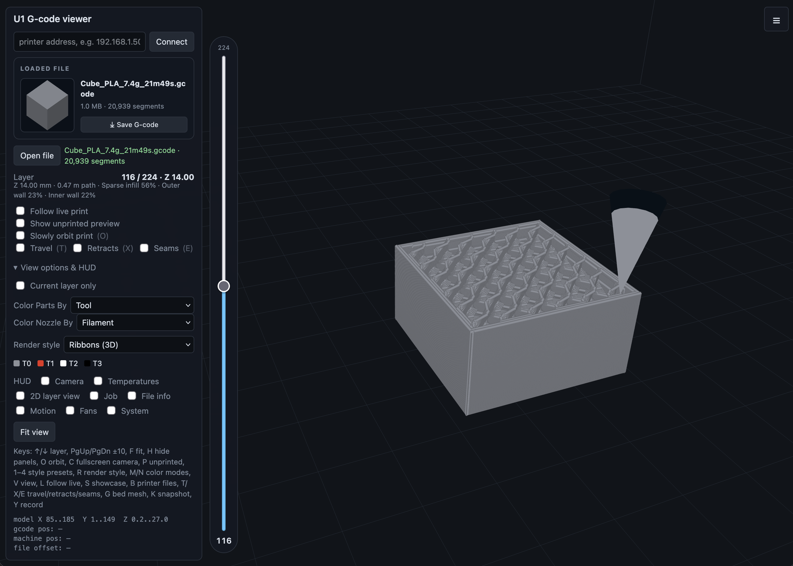

# u1-gcode-viewer

## What is it?

It's a 3D gcode visualizer as a single file in html, css, and javascript with no external dependencies (three.js is embedded).  It can also connect to a klipper/moonraker printer like a Snapmaker U1, to show the print live as its happening.  
## How do I use it?

Just open it and drag a gcode file into it.

If you want to connect to your printer, you can't just open it as a file; it has to be served from a server.  You can put it somewhere, run `python3 -m http.server 8080` from the same folder, and go to localhost:8080 in your browser.

## Why should I use it?

The webcam works on the Snapmaker U1.  That was driving me crazy.

## Is it slop?

Yeah.

